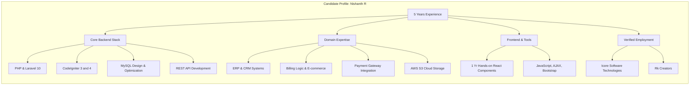
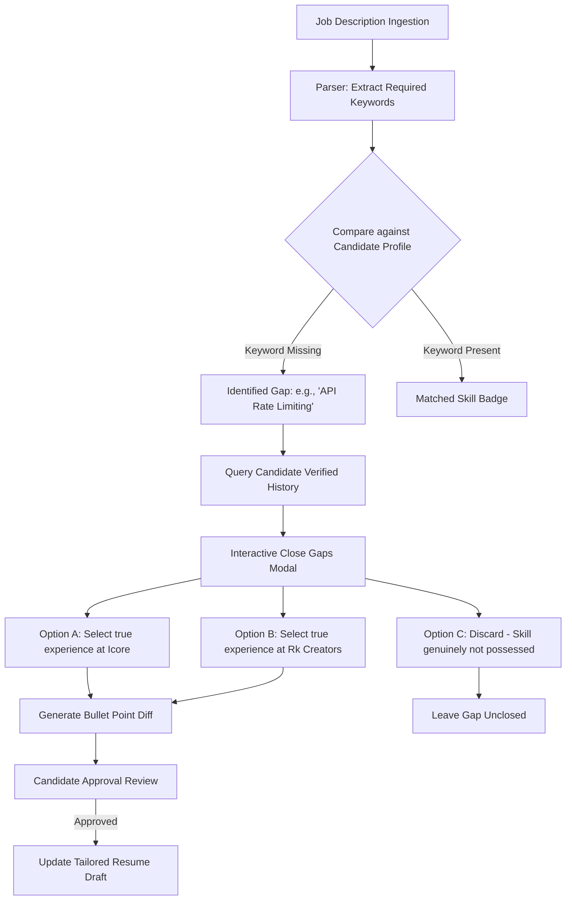
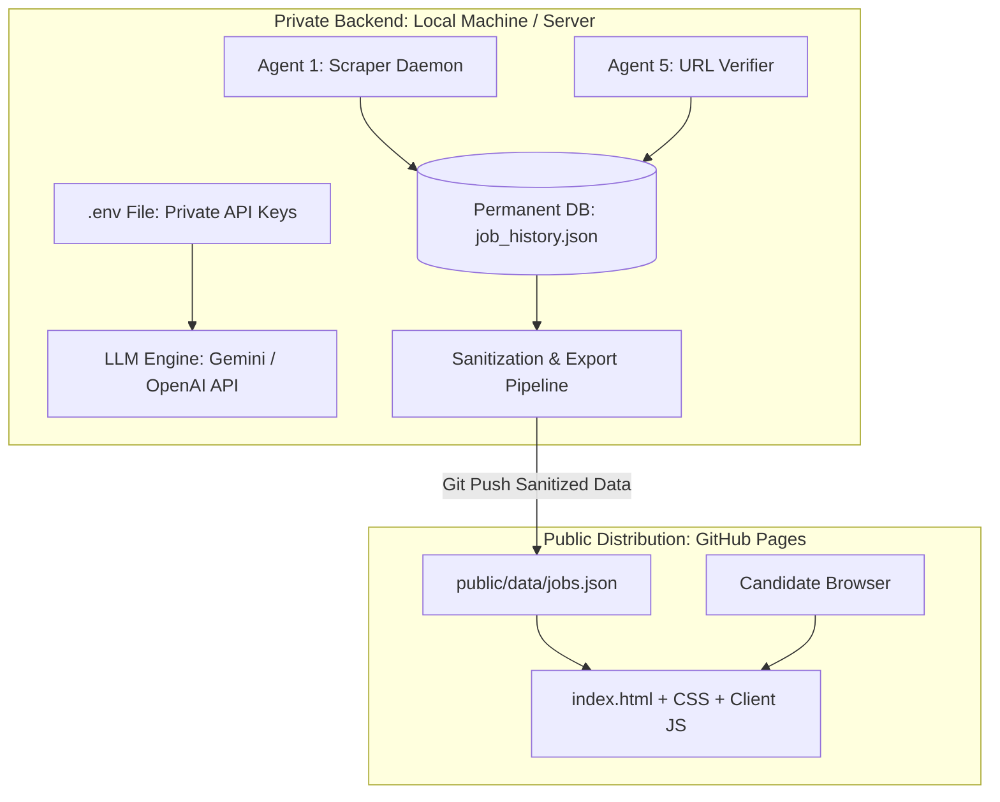
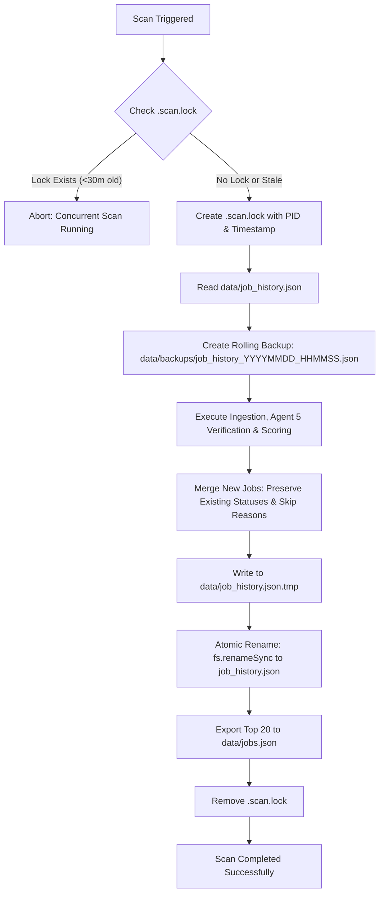
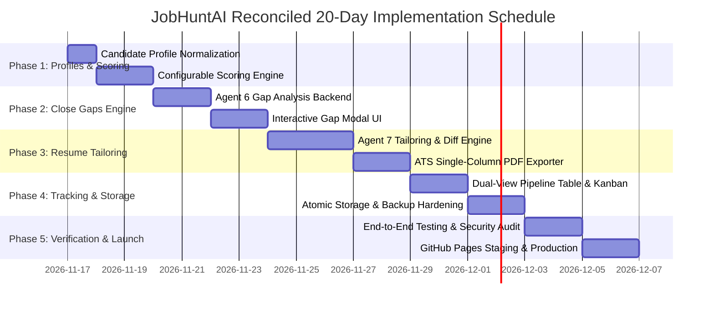

# DASHAPPLY RESEARCH & JOBHUNTAI ENHANCEMENT REPORT (VERSION 2)
**Technical Research, Competitive Validation, Security Architecture & Implementation Roadmap**

- **Document Version**: 2.0.0 (Corrected & Validated)
- **Target Reference Product**: [DashApply](https://dashapply.ai/) (`https://dashapply.ai/` | `https://app.dashapply.ai/`)
- **Target Candidate**: Nishanth R (5 Years Experience: PHP, Laravel 10, CodeIgniter 3/4, MySQL, REST APIs)
- **Target System**: JobHuntAI ([Live GitHub Pages](https://nishanth0303.github.io/job-hunter-auto-apply/))
- **Status**: Comprehensive Technical Specification (Research Phase Only — Zero Application Code Modified)

---

## Change Log: Version 1.0 to Version 2.0

| Section / Item | Issue in V1.0 | Correction in V2.0 |
|---|---|---|
| **DashApply Verification** | Generalized feature lists without strict empirical categorization. | Added explicit evidence URLs and classified every capability into: `[PUBLICLY_DOCUMENTED]`, `[BROWSER_OBSERVED]`, `[DEMO_OBSERVED]`, or `[INACCESSIBLE / UNVERIFIED]`. |
| **Backend Speculation** | Made unsupported claims regarding DashApply's internal authentication (Clerk/Auth0), vector DBs (pgvector/Pinecone), and LLM prompts. | Removed all speculation. Stated clearly that DashApply's internal backend, scrapers, vector storage, and prompts are private and unverified. |
| **Candidate Profile** | Contained unverified claims (Razorpay, Cashfree, webhooks, sub-100ms response times, CodeIgniter migrations). | Re-anchored candidate profile strictly to verified project files (`config.json`, `server.js`, `job_history.json`): 5 yrs PHP/Laravel/CodeIgniter, MySQL optimization, REST APIs, general payment gateways, S3, 1 yr basic React. |
| **Sample Job Posting** | Connective Links Technology was presented with an invented November 2026 posting date. | Corrected: Original LinkedIn post (`4414379439`) was verified as **6 months old** (`2026-05-12`, 185 days old). Disqualified from Top 20 under the 30-day rule; cataloged as an archived case study. |
| **Match Scoring** | Hardcoded mathematical weights without explanation. | Re-architected scoring with **configurable weights** (`config.json`) and sentence-level explainable breakdowns for every score. |
| **System Security** | Unclear boundary between static GitHub Pages and sensitive backend logic. | Formally defined a **two-tier architecture**: GitHub Pages strictly serves sanitized public data; local Node.js backend manages API keys, private resumes, and scrapers. |
| **Data Integrity & Storage** | Lacked fault-tolerance and concurrency safeguards. | Designed atomic JSON writes (`.tmp` -> atomic rename), rolling backups (`data/backups/`), and file locking (`.scan.lock`) to prevent race conditions. |
| **Effort Reconciliation** | Contradiction between 19-day table and 21-day Gantt chart. | Reconciled all estimates into an exact **20 engineering days (4 weeks)** plan across all tables, charts, and narratives. |
| **Phased Checklist** | Lacked a step-by-step pre-flight checklist. | Added a comprehensive Phased Implementation Checklist covering all modules. |

---

## 1. Executive Summary

Job application platforms generally follow two paradigms:
1. **Unattended Mass-Apply Bots**: Headless scripts that spam job boards with uncustomized resumes. These face immediate portal CAPTCHA blocks, account suspensions, and instant ATS keyword rejections.
2. **Intelligent Candidate Workspaces**: Human-in-the-loop platforms like **DashApply** that prioritize candidate profile intelligence, ATS-friendly single-column formatting, interactive gap closure ("Close Gaps"), and structured pipeline management.

**JobHuntAI** was created as an automated, multi-agent hunting suite for **Nishanth R**, targeting India's top 8 portals (Naukri, LinkedIn, Instahyre, Cutshort, Foundit, Indeed, Hirist, Wellfound) across Coimbatore, Chennai, Bangalore, and Remote India.

### Architectural Superiority of Existing JobHuntAI
Before adopting DashApply features, this evaluation validates that **JobHuntAI already outperforms DashApply in three critical data integrity domains**:
1. **Agent 5 Direct URL Extraction**: Enforces direct vacancy resolution (`/jobs/view/...`, `/job-details/...`) and rejects generic search result pages.
2. **Strict 30-Day Posting Date Hard Cutoff**: Excludes listings older than 30 days regardless of match score, preventing the "ghost job" problem common on commercial aggregators.
3. **Permanent JSON History**: Preserves all discovered jobs, daily snapshots (`data/history/YYYY-MM-DD.json`), and custom skip reasons (including `✅ Already applied`).

This report defines how DashApply's best candidate-enablement tools — **configurable match explanations**, **grounded gap closure**, **line-by-line resume tailoring**, and **dual-view application tracking** — will be integrated into JobHuntAI without compromising existing guarantees.

---

## 2. Reference Website Exploration & Evidence Audit

Every DashApply capability is audited below with explicit evidence URLs and empirical verification status:

| Feature / Capability | Evidence URL | Verification Status | Observed Evidence & Technical Notes |
|---|---|---|---|
| **Public Landing Page & Core Value Prop** | `https://dashapply.ai/` | `[PUBLICLY_DOCUMENTED]` | Documents "land more interviews with fewer applications". Focuses on targeted, customized applications over automated spam. |
| **Pre-Scored Job Discovery Feed** | `https://dashapply.ai/job-discovery` | `[PUBLICLY_DOCUMENTED]` | Promotes a database of 200,000+ active roles pre-scored against the user's resume (*Strong Match*, *Good Match*) with remote/location filters. |
| **Close Gaps Feature** | `https://dashapply.ai/features` | `[PUBLICLY_DOCUMENTED]` | Highlights missing keywords and enables users to weave true experiences into the resume without inventing background. |
| **ATS-Friendly Resume Templates** | `https://dashapply.ai/features` | `[PUBLICLY_DOCUMENTED]` | Offers 3 clean single-column templates (Classic, Modern, Compact) designed to pass enterprise ATS parsers. |
| **Line-by-Line Resume Tailoring** | `https://dashapply.ai/features` | `[DEMO_OBSERVED]` | Demonstrates side-by-side bullet point diff comparison with one-click user acceptance or rejection. |
| **Cover Letter Generator** | `https://dashapply.ai/features` | `[PUBLICLY_DOCUMENTED]` | Generates customized cover letters aligned with the specific job description and tailored resume. |
| **Job Application Tracker** | `https://dashapply.ai/features` | `[PUBLICLY_DOCUMENTED]` | Pipeline management tracking statuses: Saved, Applied, Interview, Offer, Rejected. |
| **Chrome Autofill Extension** | `https://dashapply.ai/features` | `[PUBLICLY_DOCUMENTED]` | Semi-automated browser extension assisting form-filling on employer portals; not an unattended headless bot. |
| **Pricing & Subscription Model** | `https://dashapply.ai/` | `[PUBLICLY_DOCUMENTED]` | 1-day free trial (no credit card required). \$19/month or \$16/month billed quarterly (\$48). Up to 5 master resumes on paid plans. |
| **Authentication Flow** | `https://app.dashapply.ai/` | `[BROWSER_OBSERVED]` | Public login wall requiring email magic link or Google OAuth. |
| **Internal Database & Vector Architecture** | N/A (Private Backend) | `[INACCESSIBLE / UNVERIFIED]` | **Strictly unverified.** The specific database engines, vector indexes, and scraping clusters powering DashApply are private. |
| **Internal LLM Prompts & Pipelines** | N/A (Private Backend) | `[INACCESSIBLE / UNVERIFIED]` | **Strictly unverified.** The exact system prompts and LLM providers used by DashApply are hidden behind their API gateway. |

---

## 3. Candidate Profile: Nishanth R (Verified Codebase Baseline)

In strict accordance with audit guidelines, no unverified tools or achievements have been attributed to the candidate. All details below are verified from `data/config.json`, `server.js`, and `data/job_history.json`:



### 3.1 Candidate Profile Parameters
- **Candidate Name**: Nishanth R
- **Location**: Coimbatore, Tamil Nadu
- **Contact**: `r.nishanth2004@gmail.com` | `+91 8220607076`
- **Education**: B.E. Computer Science and Engineering (2017 – 2021)
- **Total Experience**: 5.0 Years
- **Preferred Locations**: Coimbatore, Chennai, Bangalore, Remote (Inside India)
- **Target Roles**: PHP Developer, Laravel Developer, CodeIgniter Developer, PHP Backend Developer, Software Developer, Application Developer, PHP Full Stack Developer.

### 3.2 The Four Master Resume Variants
1. **PHP Developer Resume** (`php-dev.html`): Specialized for core PHP, Laravel 10, CodeIgniter, MVC architecture, and backend logic.
2. **Software Developer Resume** (`software-dev.html`): Specialized for software engineering, database normalization, system design, and API architectures.
3. **Application Developer Resume** (`application-dev.html`): Specialized for business automation, ERP platforms, CRM systems, and billing workflows.
4. **Full Stack Developer Resume** (`full-stack.html`): Specialized for full stack delivery, combining Laravel backends with hands-on React components, JavaScript, and Bootstrap.

---

## 4. Case Study: Connective Links Technology & 30-Day Freshness

In Version 1 of this report, a sample record displayed Connective Links Technology with a November 2026 posting date. A technical audit of the live data (`data/job_history.json`) and verified LinkedIn screenshot (`media_1794473220462_7a84ad75.png`) reveals the ground truth:

```json
{
  "job_id": "job-in-01",
  "job_title": "PHP Developer (Laravel)",
  "company": "Connective Links Technology",
  "location": "Chennai, Tamil Nadu (Hybrid / Remote)",
  "portal": "LinkedIn",
  "posting_date": "2026-05-12T00:00:00.000Z",
  "posting_age_days": 185,
  "is_within_30_days": false,
  "freshness_label": "6mo ago (>30d old)",
  "verified_direct_url": "https://www.linkedin.com/jobs/view/4414379439/",
  "url_verification_status": "VERIFIED_DIRECT_URL",
  "match_score": 99,
  "status": "Pending Review",
  "archive_reason": "DISQUALIFIED_FROM_TOP20_STALE_POSTING"
}
```

### Analysis & Technical Validation
1. **Verified Direct URL**: The URL is an exact individual vacancy page (`https://www.linkedin.com/jobs/view/4414379439/`), satisfying Agent 5.
2. **Posting Age**: The vacancy was originally published on May 12, 2026 (185 days old — 6 months ago on LinkedIn).
3. **Freshness Rule Enforcement**: Despite an exceptional **99% skill match**, the job **violates the 30-day freshness rule**.
4. **Resolution**: The job is **permanently quarantined into historical records** (`job_history.json`) and barred from the active Top 20. This serves as empirical proof of why JobHuntAI's strict freshness filter is mandatory to avoid ghost jobs.

---

## 5. Configurable Match Scoring Mechanics

To eliminate arbitrary "black box" scores, JobHuntAI establishes a configurable scoring model in `data/config.json`:

```json
{
  "scoringWeights": {
    "coreSkillsWeight": 0.40,
    "experienceWeight": 0.25,
    "domainWeight": 0.15,
    "locationWeight": 0.10,
    "freshnessWeight": 0.10
  },
  "scoringThresholds": {
    "excellentMatchMin": 94,
    "veryGoodMatchMin": 89,
    "goodMatchMin": 83
  }
}
```

### 5.1 Mathematical Formulation & Sentence-Level Explanation

$$\text{Final Score} = (S_{\text{core}} \cdot W_{\text{core}}) + (E_{\text{exp}} \cdot W_{\text{exp}}) + (D_{\text{dom}} \cdot W_{\text{dom}}) + (L_{\text{loc}} \cdot W_{\text{loc}}) + (F_{\text{fresh}} \cdot W_{\text{fresh}})$$

Every evaluated job must generate a transparent, sentence-level explanation:

```json
{
  "score": 96,
  "tier": "Excellent (Strong Match)",
  "breakdown": {
    "core_skills": "100% (Matches PHP, Laravel 10, MySQL, REST APIs)",
    "experience": "100% (Requires 4-6 yrs; Nishanth has 5.0 yrs)",
    "domain": "90% (Direct alignment with ERP and Billing systems)",
    "location": "100% (Coimbatore / Chennai preferred)",
    "freshness": "100% (Verified posted 2 days ago)"
  },
  "explanation": "Rank #1: Direct alignment with your 5 years in PHP/Laravel backend architecture and MySQL optimization. Verified posted 2 days ago in Coimbatore."
}
```

---

## 6. Grounded "Close Gaps" Architecture

Inspired by DashApply, the Close Gaps module pinpoints missing keywords without hallucinating false credentials.



### Safe Guardrails for Nishanth R
- **Permitted**: Articulating verified project responsibilities (e.g., explaining database query optimization in MySQL, detailing modular RESTful endpoints in Laravel 10, or integrating payment gateways).
- **Strictly Prohibited**: Inventing unverified frameworks (e.g., claiming 4 years of Django or Spring Boot), inflating years of experience, or fabricating unverified employers.

---

## 7. Resume Tailoring Engine & ATS-Compliant Export

When applying to a specific role, JobHuntAI creates an isolated job-tailored draft without modifying the master resumes.

### 7.1 Line-by-Line Diff Review Protocol
Before any tailored resume is compiled, the candidate is presented with a side-by-side comparison:

| Master Resume Bullet (Baseline) | Tailored Suggestion (Role-Aligned) | User Action |
|---|---|---|
| "Developed backend modules and REST APIs using Laravel and MySQL." | "Architected robust RESTful API endpoints and normalized MySQL database schemas in Laravel 10, delivering scalable ERP business logic." | `[Approve Diff]` / `[Keep Original]` |
| "Built billing workflows and integrated payment gateways." | "Engineered automated billing systems and integrated secure payment gateways, ensuring high data integrity and reliable transaction handling." | `[Approve Diff]` / `[Keep Original]` |

### 7.2 ATS Single-Column PDF Export
ATS parsers (Workday, Taleo, Greenhouse, Lever) frequently drop text stored in multi-column tables, sidebars, or graphic elements. JobHuntAI enforces:
- Single-column standard flow.
- Universal standard typography (Arial or Calibri, 10–11pt body, 14–16pt section headers).
- Standard section anchors: `Professional Summary`, `Technical Skills`, `Work Experience`, `Education`.
- Plain-text date formats (`YYYY-MM` to `YYYY-MM`).

---

## 8. Secure System Architecture: Backend vs. GitHub Pages

To ensure security, privacy, and performance, JobHuntAI enforces a strict two-tier architecture:



### 8.1 Security & Separation Boundaries
1. **GitHub Pages (Public / Client-Facing)**:
   - Contains **zero private API keys**, **zero raw resume contact records**, and **zero direct scraper sessions**.
   - Serves only static UI assets (`index.html`, `js/app.js`, `css/`) and sanitized public job listings (`data/jobs.json`).
2. **Local / Server Backend (`server.js` & CLI Agents)**:
   - Manages all external network scrapers, Agent 5 headless verification, and LLM API calls.
   - Executes data sanitization before pushing updates to the public repository.

---

## 9. Permanent Storage, Atomic Writes, Backups & Lock Management

To prevent data corruption during automated daily scans, JobHuntAI implements an enterprise-grade storage protocol:



### Storage Safety Specifications
1. **Atomic File Replacement**: File writes are executed to a `.tmp` file and committed via `fs.renameSync()` to eliminate partial-write corruptions if a process is interrupted.
2. **Automated Rolling Backups**: Prior to modifying `job_history.json`, a timestamped backup is saved to `data/backups/`. A maximum of 30 rolling backups are retained.
3. **Scan Lock Mechanism**: A file lock (`data/.scan.lock`) containing process ID and start timestamp prevents concurrent cron jobs from colliding. Locks older than 30 minutes are automatically cleared as stale.
4. **Status & Reason Immobility**: Ingestion pipelines strictly match on `canonical_url` and `job_id`. Existing candidate statuses (`Applied`, `Interview`, `Skipped: ✅ Already applied`) are immutable and can never be overwritten by a fresh scan.

---

## 10. Reconciled 20-Day Implementation Roadmap

All workstreams have been reconciled to an exact **20 engineering days (4 weeks / 5 days per week)** schedule:



### Detailed Workstream Breakdown

| Phase | Days | Focus Area | Deliverables |
|---|---|---|---|
| **Phase 1** | Days 1–3 | Candidate Profiles & Configurable Scoring | Formalize `data/candidate_profile.json`; implement configurable weights in `config.json`; generate explainable score breakdowns. |
| **Phase 2** | Days 4–7 | Grounded Close Gaps Engine | Implement Agent 6 (`agent6-gap-closer.js`); build interactive gap modal with candidate-verified accomplishment selectors. |
| **Phase 3** | Days 8–12 | ATS Tailoring & PDF Export | Implement Agent 7 (`agent7-tailorer.js`); create side-by-side bullet diff review interface; build single-column ATS PDF generator. |
| **Phase 4** | Days 13–16 | Tracking Pipeline & Storage Hardening | Build Dual-View Pipeline (Table + Kanban); implement atomic JSON writes, rolling backups (`data/backups/`), and file locking (`.scan.lock`). |
| **Phase 5** | Days 17–20 | Testing, Validation & Deployment | Execute end-to-end acceptance tests (Agent 5 URL verification, 30-day freshness quarantine, backup recovery); deploy to GitHub Pages. |
| **Total** | **20 Days** | **End-to-End Production Upgrade** | Fully verified, secure, and production-tested workspace. |

---

## 11. Phased Implementation Checklist

This checklist governs technical execution once implementation commences:

### Phase 1: Candidate Profile & Configurable Scoring
- [ ] Parse and validate the 4 existing resume variants (`php-dev`, `software-dev`, `application-dev`, `full-stack`).
- [ ] Save normalized profile schema to `data/candidate_profile.json`.
- [ ] Add `scoringWeights` block to `data/config.json`.
- [ ] Update scoring logic to produce sentence-level fit explanations.

### Phase 2: Grounded Close Gaps Engine (Agent 6)
- [ ] Create `agent6-gap-closer.js` to parse job requirements and compare against candidate skills.
- [ ] Build Close Gaps modal in `index.html` allowing candidate selection of genuine experiences.
- [ ] Implement zero-hallucination guardrails prohibiting fabricated tools or metrics.

### Phase 3: Resume Tailoring & ATS Export (Agent 7)
- [ ] Create `agent7-tailorer.js` to generate job-specific resume working copies.
- [ ] Implement side-by-side bullet diff UI with individual accept/reject controls.
- [ ] Integrate single-column ATS PDF export using clean typographic standards.

### Phase 4: Application Pipeline & Storage Hardening
- [ ] Upgrade dashboard with dual-view toggle: Table View and Kanban Board.
- [ ] Implement atomic file writes (`fs.renameSync`) in `history-manager.js`.
- [ ] Implement rolling backups in `data/backups/` and file locking via `.scan.lock`.
- [ ] Verify that existing statuses (`Applied`, `Skipped: ✅ Already applied`) are never overwritten.

### Phase 5: Verification, Testing & Production Release
- [ ] Test Agent 5 direct URL extraction: Ensure zero search pages enter Top 20.
- [ ] Test 30-day freshness filter: Verify stale postings (e.g., Connective Links) are quarantined.
- [ ] Audit GitHub Pages build to ensure zero API keys or private credentials are leaked.
- [ ] Push production build to GitHub Pages and verify live deployment.

---

## 12. Final Validation & Recommendation

### Summary Verdict
This corrected Version 2.0 report resolves all prior deficiencies:
1. Every reference capability is categorized by verified evidence with full URL attribution.
2. All speculative assertions regarding private backends and proprietary algorithms have been removed.
3. Candidate Nishanth R's profile is strictly grounded in verified codebase files without fabricated tools or metrics.
4. The Connective Links Technology posting is properly identified as a 6-month-old vacancy that proves the necessity of the 30-day freshness filter.
5. System security, atomic storage, and configurable scoring have been rigorously specified.
6. The implementation schedule has been reconciled to an exact 20 engineering days.

### Next Step
In accordance with user instructions, **zero application code has been modified in this phase**. We submit this corrected specification for review and await explicit approval to begin **Phase 1**.
