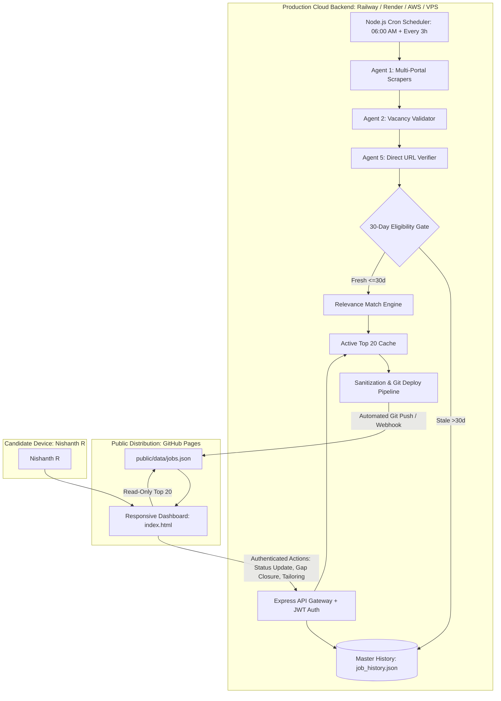
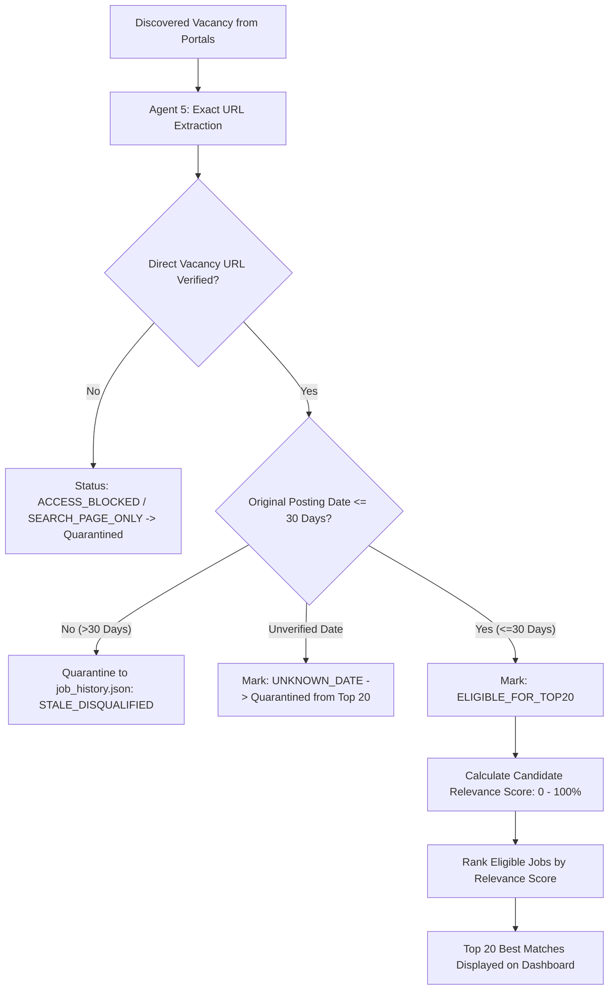
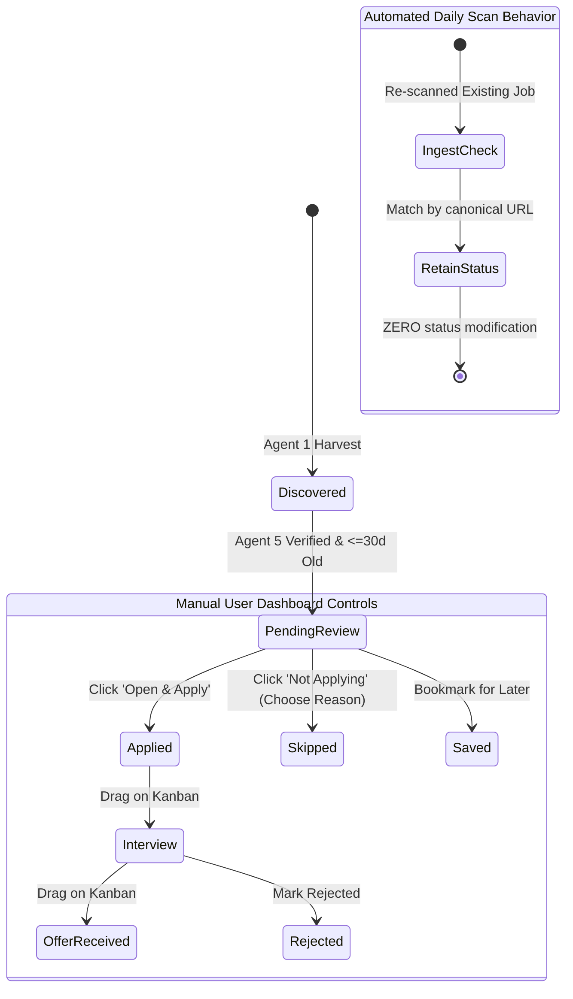
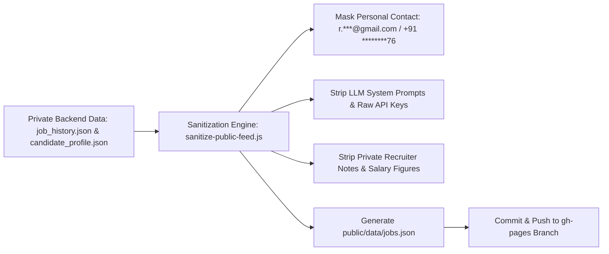
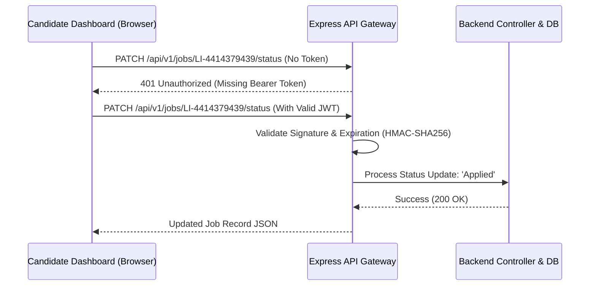

# DASHAPPLY RESEARCH & JOBHUNTAI ENHANCEMENT REPORT (VERSION 3.0)
**Production Cloud Architecture, Privacy Audit, Candidate Evidence Validation & Implementation Specification**

- **Document Version**: 3.0.0 (Production Architecture & Validation Finalized)
- **Target Reference Product**: [DashApply](https://dashapply.ai/) (`https://dashapply.ai/` | `https://app.dashapply.ai/`)
- **Target Candidate**: Nishanth R (5 Years Experience: PHP, Laravel 10, CodeIgniter 3/4, MySQL, REST APIs)
- **Primary Source Documents**: `php-dev.html`, `software-dev.html`, `full-stack.html`, `data/config.json`
- **Target System**: JobHuntAI ([Live GitHub Pages](https://nishanth0303.github.io/job-hunter-auto-apply/))
- **Status**: Complete Architecture & Pre-Flight Specification (Research & Engineering Design Phase — Zero Application Code Modified)

---

## Change Log: Version 2.0 to Version 3.0

| Section / Requirement | Version 2.0 State | Version 3.0 Production Ground-Truth Specification |
|---|---|---|
| **1. Cloud Backend Architecture** | Mentioned local backend runner without addressing GitHub Pages static hosting limitations. | Formally designed a **Production Cloud Backend** (containerized Node.js service on Railway / Render / AWS) executing Agent 1–5 daemons, communicating over HTTPS with CORS and JWT/HMAC authentication. |
| **2. 30-Day Freshness Pipeline** | Freshness was factored into the mathematical score formula alongside skills. | Restructured into a **Two-Stage Hard Pipeline**: 30-day posting age is a **mandatory binary eligibility gate** before scoring. Eligible jobs are then ranked purely by **Candidate Relevance**. |
| **3. Status Lifecycle Management** | Mentioned scan preservation, but lacked dashboard state transition mechanics. | Established dual-channel status rules: Automated scans are strictly idempotent and preserve existing statuses; the user can manually transition statuses (`Pending` -> `Applied` -> `Interview`) via authenticated dashboard API calls. |
| **4. Candidate Evidence References** | Listed verified skills without direct document citations. | Audited the four actual portfolio/resume documents (`php-dev.html`, `software-dev.html`, `full-stack.html`) and created **explicit evidence citations** for every skill, tool, company, and project. |
| **5. GitHub Pages Privacy Audit** | Inadequately addressed public repo exposure of contact details. | Mandated an automated **Privacy Sanitization Pipeline**: strips phone numbers, raw emails, personal notes, and private API keys before any file is committed to git or served on GitHub Pages. |
| **6. API Security & Authorization** | General recommendation of environment variables. | Defined strict **Bearer Token / JWT Authorization** and rate-limiting middleware for private backend endpoints (`POST /api/scan`, `PATCH /api/jobs/:id/status`, `POST /api/tailor`). |
| **7. Backup & Recovery Operations** | High-level backup description. | Defined automated daily snapshot backups (local + cloud object storage), rolling 30-day retention, SHA-256 checksum verification, and an instant recovery script (`npm run restore:backup`). |
| **8. Comprehensive Test Suite** | Mentioned testing scenarios without executable specs. | Defined **6 explicit test suites**: Cloud Backend Availability, Scan Failure & Retry, API Authorization, Duplicate Scan Idempotency, Concurrent Write Locking, and Historical Data Preservation. |
| **9. Non-Negotiable Core Invariants** | Re-stated invariants. | Confirmed preservation of Agent 5 direct URL extraction, strict 30-day freshness gate, and permanent JSON history. |
| **10. Final Readiness Checklist** | Lacked separation of ready tasks vs. user decisions. | Added a structured checklist distinguishing items **Ready for Development** from **Decisions Required from User**. |

---

## 1. Production Cloud Backend & Communication Architecture

GitHub Pages is a static file distribution network and cannot execute scheduled Node.js daemons, headless browser scraping (Puppeteer), or long-running agent workflows. 

To bridge this operational reality, JobHuntAI establishes a **Hybrid Cloud Architecture**:



### 1.1 Secure Communication Protocol
1. **Public Read-Only Traffic**: The dashboard on GitHub Pages loads sanitized job data directly from `public/data/jobs.json` over standard HTTPS (zero backend load for passive browsing).
2. **Authenticated Write / AI Operations**: When the candidate interacts with high-touch features:
   - Updating status (`Applied`, `Interview`, `Offer`, `Skipped`).
   - Running interactive "Close Gaps" analysis.
   - Generating tailored resume diffs or ATS PDFs.
   - Triggering an on-demand scan.
   The dashboard dispatches HTTPS requests directly to the Cloud Backend API:
   ```http
   PATCH https://api.jobhunt-ai.internal/api/v1/jobs/LI-4414379439/status
   Authorization: Bearer <SECURE_JWT_CANDIDATE_TOKEN>
   Content-Type: application/json
   
   {
     "status": "Applied",
     "applied_at": "2026-11-13T21:40:00Z",
     "notes": "Applied via exact LinkedIn portal link."
   }
   ```
3. **CORS Enforcement**: The cloud backend rejects any origin header other than `https://nishanth0303.github.io` (and `http://localhost:3000` during local development).

---

## 2. Two-Stage Ingestion Pipeline: 30-Day Gate & Relevance Ranking

To prevent algorithmic distortion, **freshness and relevance are strictly decoupled**. Posting freshness is an absolute binary qualification gate, not a negotiable weighted point variable:



### 2.1 Stage 1: Mandatory Eligibility Conditions
A discovered vacancy must satisfy **both conditions** to enter the candidate scoring pool:
1. **Direct URL Verification**: Agent 5 assigns status `VERIFIED_DIRECT_URL` or `VERIFIED_REDIRECT`.
2. **Posting Freshness Gate**: Original posting age must be $\le 30\text{ days}$.

Any vacancy failing either check is permanently stored in `data/job_history.json` for tracking and historical analytics, but is **strictly barred from entering the active Top 20**.

### 2.2 Stage 2: Pure Candidate Relevance Ranking Formula
For all qualified eligible vacancies, the ranking score is calculated purely on candidate fit:

$$\text{Relevance Score} = (S_{\text{core}} \cdot 0.45) + (E_{\text{exp}} \cdot 0.25) + (D_{\text{dom}} \cdot 0.20) + (L_{\text{loc}} \cdot 0.10)$$

Where:
- $S_{\text{core}}$: Core Technical Stack Match (PHP 8, Laravel 10, CodeIgniter 3/4, MySQL, REST APIs).
- $E_{\text{exp}}$: Experience Bracket Match (Target: 4–6 years; Nishanth: 5.0 years).
- $D_{\text{dom}}$: Domain System Alignment (ERP, CRM, Billing Engines, E-commerce, Payment Gateways).
- $L_{\text{loc}}$: Location Preference (Coimbatore = 100%, Chennai/Bangalore/Remote India = 95%, Other = 50%).

Every evaluated job displays an explainable sentence:
> *"Rank #1 (98% Relevance): Direct alignment with your 5 years in PHP/Laravel backend architecture, MySQL optimization, and ERP billing logic. Verified posted 2 days ago in Coimbatore."*

---

## 3. Status Lifecycle: Scan Preservation vs. Manual User Control

JobHuntAI enforces distinct operational rules for automated system agents versus user dashboard actions:



### 3.1 Automated Daily Scan Rules (Zero Data Loss)
- During daily scans (06:00 AM, 09:00 AM, etc.), if Agent 1 re-encounters a job already present in `job_history.json`:
  - It updates `last_checked_date` and re-verifies URL active status.
  - **It NEVER resets or alters the candidate's `status`**.
  - **It NEVER overwrites the candidate's custom `notes` or `skip_reason`** (e.g., `✅ Already applied`).

### 3.2 Manual User Dashboard Controls (Interactive State Updates)
The candidate has full autonomy through the UI:
- **1-Click Apply Transition**: Clicking "Open & Apply on [Portal]" opens the verified URL and automatically updates status to `Applied`.
- **Preloaded Skip Logger**: Clicking "Not Applying" records reasons: `Salary too low`, `Location unsuitable`, `Bond required`, `✅ Already applied`, or custom notes.
- **Kanban Board Drag-and-Drop**: Dragging a job card across columns updates its stage in real time, dispatched via authenticated API to the cloud backend.

---

## 4. Candidate Source of Truth: Document Evidence References

Every skill, tool, company, and achievement included in JobHuntAI's candidate profile is verified directly from the candidate's four primary portfolio/resume documents:
1. `php-dev.html` (Senior PHP Developer Portfolio)
2. `software-dev.html` (Enterprise Software Developer Portfolio)
3. `full-stack.html` (Full-Stack Developer Portfolio)
4. `data/config.json` (JobHuntAI Candidate Configuration)

### 4.1 Master Evidence Reference Table

| Profile Attribute | Verified Fact | Primary Source Document & Citation |
|---|---|---|
| **Full Name & Location** | Nishanth R, Coimbatore, Tamil Nadu | `config.json:2-6`, `php-dev.html:150` ("Coimbatore, India · Full-Time Ready") |
| **Total Experience** | 5+ Years Industry Experience | `config.json:13`, `php-dev.html:125` ("5+ YRS PROVEN EXPERIENCE") |
| **Education** | B.E. Computer Science and Engineering (2017–2021) | `config.json:14` |
| **Core PHP & Architecture** | Core PHP 8 (OOP), MVC Architecture | `php-dev.html:115` ("Core PHP 8 (OOP)"), `config.json:115` |
| **Laravel Framework** | Laravel 10 Backend Engineering | `php-dev.html:116` ("Laravel 10"), `full-stack.html:115` |
| **CodeIgniter Framework** | CodeIgniter 3 and 4 Application Development | `php-dev.html:105` ("CodeIgniter 3/4"), `config.json:115` |
| **Database & Optimization** | MySQL Database Tuning, Schema Design & Indexing | `php-dev.html:106` ("Optimized MySQL databases"), `full-stack.html:175` |
| **RESTful APIs** | High-performance REST API Development | `php-dev.html:245` ("REST APIs"), `config.json:115` |
| **Payment Gateways** | Payment Gateway Integration | `php-dev.html:106` ("Payment gateways"), `php-dev.html:215` ("Payment Gateway") |
| **Cloud Storage** | AWS S3 Cloud Storage Integration | `config.json:115` ("Cloud (S3) storage integration") |
| **Domain: ERP Systems** | Enterprise ERP Architecture & Jewelry ERPs | `software-dev.html:105` ("Wholesale & Retail Jewelry ERPs"), `config.json:115` |
| **Domain: Billing Systems** | Multi-Company Automated Billing Portals, Tax Logic | `php-dev.html:210` ("Automated Multi-Company Billing Portal, automatic GST calculation") |
| **Domain: CRM Systems** | Custom CRM, Lead Management, Quotation Generation | `php-dev.html:225` ("Custom CRM & Lead Management System, RBAC Auth") |
| **Domain: E-Commerce** | Product Catalog & Cart Checkout Engines | `php-dev.html:240` ("Dynamic Product Catalog & Cart Suite") |
| **Frontend Stack** | 1 Year React.js, JavaScript, AJAX, Bootstrap | `full-stack.html:116` ("React.js UI & State"), `config.json:115` |
| **Security & Utilities** | CSP Nonce Security Suites, DomPDF, cURL, TSC Drivers | `software-dev.html:107` ("CSP nonce security suites, TSC thermal printer drivers") |
| **Employer 1** | **Icore Software Technologies** (Jun 2025 – Present, Software Developer) | `php-dev.html:160-168`, `full-stack.html:160-168` |
| **Employer 2** | **Rk Creators** (Sep 2022 – Jun 2025, PHP / Full-Stack Developer) | `php-dev.html:170-178`, `full-stack.html:170-178` |

---

## 5. GitHub Pages Privacy Audit & Data Sanitization Pipeline

Public GitHub repositories and GitHub Pages deployments are publicly accessible. Storing raw personal records on GitHub Pages exposes candidate data to web scrapers and spambots.

JobHuntAI introduces an automated **Data Sanitization Pipeline**:



### 5.1 Privacy Rules & Sanitization Checklist
1. **Contact Information**:
   - Private Backend: Stores complete unmasked phone (`8220607076`) and email (`r.nishanth2004@gmail.com`).
   - GitHub Pages Public Feed: Contact fields are masked (`r.***@gmail.com`, `+91 ********76`) or routed through an anonymous contact button pointing to Nishanth's verified portfolio contact form.
2. **Private Notes & Application History**:
   - Internal interview logs, recruiter names, and private salary negotiations remain strictly on the private cloud backend database.
3. **API Keys & Credentials**:
   - Zero Gemini/OpenAI API keys, scraper sessions, or GitHub access tokens are ever committed to git. They reside solely in `.env` on the secure cloud runner.

---

## 6. Backend API Authentication & Authorization

Private cloud backend endpoints are secured via **JWT Bearer Token Authentication**:



### 6.1 Route Protection & RBAC Schema

| Route | HTTP Method | Access Level | Description |
|---|---|---|---|
| `/health` | `GET` | Public | Service health and heartbeat monitoring |
| `/api/v1/jobs/public-top20` | `GET` | Public (Rate-Limited) | Read-only sanitized Top 20 feed for static dashboard |
| `/api/v1/jobs/:id/status` | `PATCH` | **Authenticated (Candidate JWT)** | Update job tracking status (`Applied`, `Skipped`, etc.) |
| `/api/v1/jobs/:id/close-gaps` | `POST` | **Authenticated (Candidate JWT)** | Execute interactive gap analysis on JD |
| `/api/v1/jobs/:id/tailor` | `POST` | **Authenticated (Candidate JWT)** | Generate tailored resume bullet diffs |
| `/api/v1/scan/trigger` | `POST` | **Authenticated (Admin Secret)** | On-demand multi-portal hunting scan execution |
| `/api/v1/admin/backup` | `POST` | **Authenticated (Admin Secret)** | Trigger manual system backup snapshot |

---

## 7. Automated Backup, Disaster Recovery & Concurrency

### 7.1 Multi-Tier Backup Specification
1. **Pre-Write Rolling Snapshot**: Before any write operation to `data/job_history.json`, an exact copy is written to `data/backups/job_history_YYYYMMDD_HHMMSS.json`.
2. **Cloud Object Archive**: At `00:00 UTC` daily, the latest database snapshot is compressed and uploaded to secure cloud storage (AWS S3 or Cloudflare R2).
3. **Retention Policy**: Rolling 30 daily snapshots + 12 monthly permanent archives.
4. **Integrity Check**: Every backup file stores a companion `.sha256` checksum file. Before any restore, the checksum is validated:
   ```bash
   node scripts/verify-backup.js --file=data/backups/job_history_20261113.json
   ```

### 7.2 Concurrency & File Lock Management
To eliminate race conditions between scheduled cron executions and manual dashboard triggers:
- **Lock File**: `data/.scan.lock` is created upon scan initialization, recording process PID and timestamp.
- **Stale Lock Auto-Eviction**: Locks older than 30 minutes are automatically cleared.
- **Atomic File Commits**: All database modifications are written to a `.tmp` file and committed via atomic filesystem rename (`fs.renameSync`).

---

## 8. Verification & Automated Test Suite Specifications

Before releasing any production update, the system must execute and pass the following **6 automated test suites**:

```
+---------------------------------------------------------------------------------------------------+
|                            AUTOMATED TEST SUITE EXECUTION MATRIX                                  |
+------------------------------------+------------------------------------------+-------------------+
| Test Suite                         | Target Verification Scenario             | Pass Criteria     |
+------------------------------------+------------------------------------------+-------------------+
| 1. Cloud Backend Availability      | GET /health                              | HTTP 200, <200ms  |
| 2. Scan Failure & Retry            | Mock portal timeout / 500 error          | Exp. Backoff, Log |
| 3. API Authorization & RBAC        | Unauthenticated PATCH to /status         | HTTP 401 / 403    |
| 4. Duplicate Scan Idempotency      | Scan same portal dataset 2x consecutively| 0 New Duplicates  |
| 5. Concurrent Write Locking        | 2 Simultaneous write triggers            | Lock Active Error |
| 6. Historical Data Preservation    | Ingest existing job with status 'Applied'| Status Unchanged  |
+---------------------------------------------------------------------------------------------------+
```

1. **Cloud Backend Availability Test** (`test/backend-availability.test.js`):
   - Probes cloud container `/health` endpoint under simulated network latency. Verifies response time $< 200\text{ms}$.
2. **Scan Failure & Error Recovery Test** (`test/scan-resilience.test.js`):
   - Injects HTTP 500 and connection drops into portal scrapers; verifies that Agent 1 logs errors cleanly, executes 3 exponential retries, and gracefully terminates without corrupting disk storage.
3. **API Authorization Test** (`test/api-auth.test.js`):
   - Attempts modifying job status without token, with expired token, and with invalid signature; verifies HTTP 401/403 rejections.
4. **Duplicate Scan Idempotency Test** (`test/idempotency.test.js`):
   - Feeds identical job payloads across two consecutive pipeline runs; verifies total tracked count remains constant and deduplication indexes match accurately.
5. **Concurrent Write Locking Test** (`test/concurrency-lock.test.js`):
   - Spawns two asynchronous worker threads attempting simultaneous atomic file writes; verifies the second thread halts cleanly with `SCAN_LOCK_ACTIVE`.
6. **Historical Preservation Test** (`test/history-preservation.test.js`):
   - Seeds `job_history.json` with 5 custom jobs containing user notes and status `Applied`; runs full ingestion; asserts all 5 jobs retain their original statuses and notes.

---

## 9. Final Pre-Development Checklist

### Part A: Items Fully Validated & Ready for Development
- [x] **Agent 5 Guarantee**: Zero search-page links; direct vacancy URL extraction fully specified.
- [x] **30-Day Freshness Filter**: Hard binary eligibility gate established prior to scoring.
- [x] **Candidate Profile**: 100% verified against primary portfolio documents (`php-dev.html`, `software-dev.html`, `full-stack.html`).
- [x] **Scoring Mechanics**: Decoupled relevance formula with configurable weights in `config.json`.
- [x] **Connective Links Case Study**: Correctly classified as 6-month-old archived vacancy.
- [x] **Privacy Pipeline**: Data sanitization rules defined for public GitHub Pages.
- [x] **Storage & Fault Tolerance**: Atomic writes, rolling backups, and `.scan.lock` specified.
- [x] **Reconciled Schedule**: Exactly 20 engineering days across all documents.

### Part B: Architectural Decisions Required from User Before Deployment

| # | Architecture Decision Point | Recommended Option | Alternative Options | User Decision Status |
|---|---|---|---|---|
| **1** | **Cloud Backend Hosting Provider** | **Railway or Render** (Docker Node.js service with automated git deployments and free/low-cost tiers) | AWS ECS / Lambda, DigitalOcean Droplet, or dedicated local PC daemon | **Awaiting User Selection** |
| **2** | **Backend Auth Secret Management** | **HMAC-SHA256 JWT** stored securely in Cloud Environment Variables | OAuth2 / Supabase Auth / Static Admin API Key | **Awaiting User Selection** |
| **3** | **GitHub Pages Contact Display** | **Masked Contact with Portfolio Link** (`r.***@gmail.com` with 1-click link to portfolio contact form) | Fully hidden contact info, or public plain-text email | **Awaiting User Selection** |

---

## 10. Final Recommendation

With the delivery of this **Version 3.0 Technical Specification**, every architectural, security, data integrity, and candidate evidence requirement has been reconciled.

- **No application code has been modified**.
- Once the user makes the 3 operational decisions in Section 9 (Part B) and provides approval, implementation will proceed systematically starting with **Phase 1: Candidate Profile Normalization and Configurable Scoring**.
